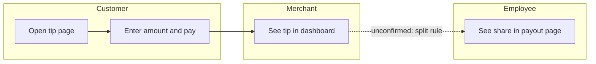
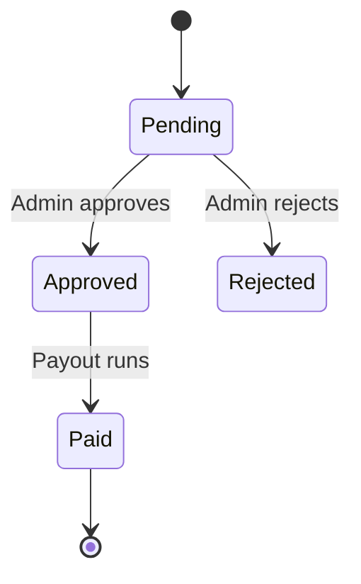
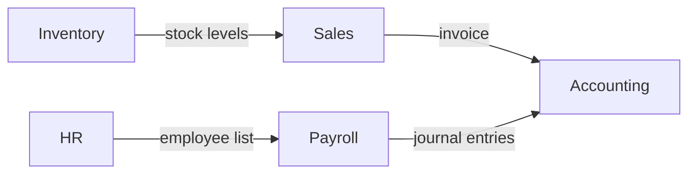
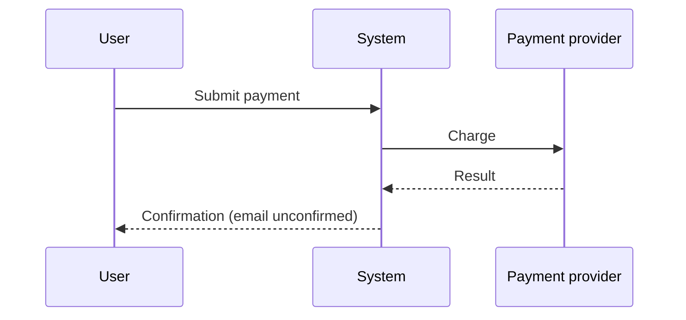

# Diagram templates (Mermaid)

Author: Destine April | dester-docs v0.1.0

Dashed arrows (`-.->`) and the word `unconfirmed` mark steps that were not seen working.

## Flow with roles as lanes

## Status lifecycle

## Module map (how data moves)

## Sequence across systems

## Roles matrix (table, words not only color)

| Action | Admin | Merchant | Employee |
|---|---|---|---|
| View payouts | Allowed | Allowed | Own only |
| Edit tip rules | Allowed | Denied | Denied |
| Export report | Allowed | Not tested | Denied |

## Coverage summary

| Area | Cases | Run | Pass | Bug | Blocked | Not run |
|---|---|---|---|---|---|---|
